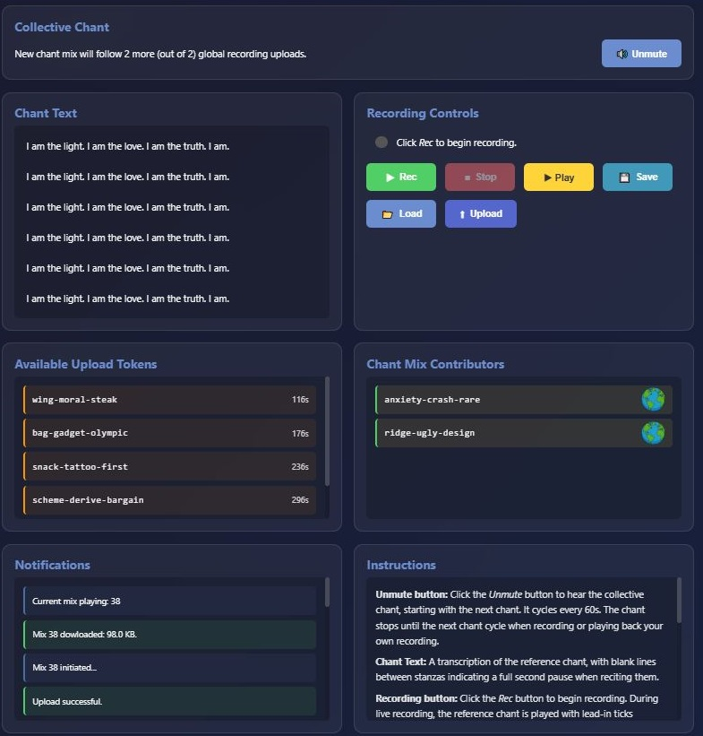

# collective-chant
A website to facilitate a collective chant or prayer.
Under development — about ready for beta testing.

## Installation
During development I am running the Collective Chant software on a local Linux box, inside a Python virtual environment.
The software uses the Python FastAPI module to serve web pages over my local network to a browser running on my remote Windows
system. I edited my Windows `hosts` file so that I can use the URL https://fastapi.local to open the main page. To use HTTPS,
certificate files were created and placed in the project directory, but a port other than 443 could have been used for testing
so that a certificate would not be needed.

### On the Linux system:
1. Install system dependencies: `sudo apt update && sudo apt install ffmpeg && sudo apt install rubberband-cli`
2. Install Python.
3. Download the project software: https://github.com/metamagical-musings/collective-chant/archive/refs/heads/main.zip
4. Unzip it then optionally move and/or rename the collective-chant-main directory as desired.
5. Inside this directory, create a virtual environment: `python3 -m venv .venv`
6. Activate the venv: `source .venv/bin/activate`
7. Install Python dependencies: `pip install -r requirements.txt`
8. Place a reference audio (named chant.mp3 by default) into the `reference` directory. (Use a short, single-stanza chant for testing.)
9. Place its associated transcription (named chant_stanzas.txt by default) into the same directory. (See below about stanzas.)
10. Start mix_worker.py: `python3 mix_worker.py test` (This should create `mixes/test.webm` using only the reference audio.)
11. In a separate terminal, start the main program (optionally using the `screen` program to allow for disconnection): `python3 main.py`
12. If using HTTPS, run: `sudo setcap 'cap_net_bind_service=+ep' $(readlink -f .venv/bin/python3)` (to allow binding to port 443)
13. If using HTTPS, create a certificate using mkcert, for example, and place fastapi.crt, fastapi.key, fastapi.pfx in the project directory.
14. If using HTTPS, open a browser and navigate to https://localhost to interact with the user interface on the local system.

### On a remote system:
1. Add a line like `xxx.xxx.xxx.xxx fastapi.local` to the `hosts` file, in admin/superuser mode.
2. Open the main Collective Chant page in a browser: https://fastapi.local (if using HTTPS)

## Software description

| Component | Purpose |
|-----------|---------|
| `index.html` | Client: uploads user-recorded audios to `main.py` via websockets. |
| `main.py` | Server: serves `index.html` to clients, saves uploaded audios to disk, signals `mix_worker.py` to begin a mix. |
| `mix_worker.py` | Audio processing worker: gathers uploaded audios from disk and mixes them upon a signal. |

### `mix_worker.py`
A standalone program that mixes `.webm` audio files found in the `uploads` directory.
The resulting mix is saved to the `mixes` directory.

The only command line argument is `mix_id` and it is optional. After the optional initial mix is done, the program
starts polling the `mixes` directory for signal files of the form `<mix_id>.mix`. If any are found, a mix is started.
The signal file is removed and the resulting mix is placed in the `mixes` directory with the name `<mix_id>.webm`,
along with a `<mix_id>.json` file that contains a dictionary of contributors to the mix. Uploaded audio files are then
removed. Polling resumes.

Automatic Speech Recognition (ASR) is used to ensure that uploaded audios are faithful recitations of the reference audio
at `ref_orig_path`. To avoid ASR degredation, audios are split into stanzas that should be less than 30 seconds in duration,
as determined by gaps (`min_gap_ms`) of near silence between them. After splitting, stanzas are compressed/stretched
to match the reference audio, then transcribed using ASR and checked for accuracy relative to the reference text
at `ref_stanzas_path` (which uses blank lines to separate stanzas — the number of which must match the number found
by splitting the audio), then reassembled with a gap of silence (`stanza_gap_ms`) between them in preparation for the mix.

When `mix_worker.py` starts, the original reference audio `ref_orig_path` (which can be any type recognized by ffmpeg,
such as *.mp3 or *.webm) is split then reassembled with both silence gaps (`stanza_gap_ms`) between stanzas and
with 3-tick count-ins between them. The former is stored in `ref_audio_path` and the latter is stored in `ref_ticks_path`,
both for use by `main.py` — the former before the first mix is created and the latter to help chanters synchronize with
the reference when recording audios for upload.

ASR is done by the module `faster_whisper`, which automatically downloads from HuggingFace and caches a language model
when `mix_worker.py` is first run. (There will be an extra delay during the first run and a warning if you do not have
a HuggingFace account — just ignore it.) `mix_worker.py` can run as a service started manually or automatically at
bootup by registering `mix_worker.service` with the system. Example commands are included as comments inside the service
file itself. Making `mix_worker.py` a service ensures that the large language model is only loaded into memory once
per session. Also, it can be run in the background at a lower priority than `main.py`.

There are many tunable constants in the `Const` object of `mix_worker.py`. Some pertaining to stanzas are:

| Constant | Suggested | Comment |
|----------|:---------:|---------|
|min_gap_ms | 1000 | Minimum (near) silence gap in uploaded audio to qualify as a stanza boundary.|
|min_speech_ms | 250 | Overlook nonsilent segments shorter than this when detecting silence gap.|
|silence_threshold_offset | 15 | dBFS offset below overall level for silence detection.|
|stanza_gap_ms | 1500 | Gap of silence to be inserted between stanzas when reassembled.|
|max_stanza_word_errors | 1 | If any single stanza exceeds this word error limit, the entire audio is rejected.|
|ratio_tolerance | 0.1 | Stanzas that must be stretched/compressed more than a factor of 1 +/- this value are silenced.|
|max_stanza_duration_errors | 1 | If more than this number of stanzas are silenced, the entire audio is rejected.|
|num_ref_audio_in_mix | 1 | Number of copies of the reference audio to add to mixes for stability. Should be >= 1 |

### `main.py`
A Python server based on the FastAPI module. It serves an HTML/JS webpage to browser clients which allows users
to listen to a chant and to upload their own chant recordings to the server to be mixed into a chorus.

`main.py` synchronizes with universal time. Chants are repeated every `time_slot_duration_sec` so their duration
must be shorter than this (by at least 5 seconds) to allow for short delays in browser audio timing and to give users
reciting the chant a chance to pause between rounds.

The first chant played is the reference chant. When `uploads_per_mix` user recordings have been successfully uploaded,
the reference chant is replaced by a mix. New mixes are created as additional recordings are uploaded.

The number of uploads per `time_slot_duration_sec` is limited to `max_uploads_per_time_slot`. This upload quota
is randomly distributed among connected users at the beginning of each time_slot by means of a random token consisting
of `words_per_token` words per token. The use of such tokens provides the following benefits:

- No user account (and no login) needed, ensuring anonymity.
- Ensures that `mix_worker.py` has enough time to mix uploaded recordings.
- Limits intentional upload flooding.

Tokens must be used within `token_expiration_sec` before they expire.

Uploaded recordings are screened before sending them to `mix_worker.py` as follows:

- Must be WebM audio.
- Must not exceed `max_upload_size_bytes` bytes.
- Duplicate recordings not allowed during a mix cycle.

Although `main.py` associates uploaded recordings with their corresponding IP addresses, both recordings and
IP addresses are erased after each mix completes to protect users' anonymity. `uploads_per_mix`
should be set large enough to provide addtional anonymity protection (10 - 20 recommended).

Recordings are also associated with corresponding upload tokens. When a mix is downloaded to connected client
browsers, a JSON file containing the tokens associated with the recordings contributed to the mix is also downloaded,
so that users will know that their contribution is included in the mix even if they cannot recognize their own voice
in the chorus. Although IP addresses are hidden from users, they are used to identify the countries associated with
contributions so that all users can know which countries contributed to the mix.

When a mix fails to complete within `mix_timeout_sec` the mix is discarded and an error is logged.

Some tunable constants in the `Const` object of `main.py`:

| Constant | Suggested | Comment |
|----------|:---------:|---------|
|time_slot_duration_sec | 60 | Playback of the mix is repeated at this interval.|
|max_uploads_per_time_slot | 1.5 | Global upload quota of tokens per time_slot.|
|token_expiration_sec | 360 | Can use 6 * time_slot_duration_sec to keep proportion.|
|max_upload_size_bytes | 10 * 1024 * 1024 | Maximum audio recording size in bytes.|
|uploads_per_mix | 2 | Set large enough to provide anonymity in the mix chorus.|
|words_per_token | 3 | Number of BIP39 words per token.|
|mix_timeout_sec | 300 | Maximum time allowed for a mix to complete.|

Suggested values are for testing.

### `index.html`
The webpage served to browser clients.

#### Context variables
The webpage is dynamic, constructed using these context variables:

| Variable | Meaning |
|----------|---------|
|chant_text | One line per stanza, stanzas separated by blank lines. |
|time_slot_duration_sec | See `main.py` section above.|
|token_expiration_sec | See `main.py` section above.|
|uploads_per_mix | See `main.py` section above.|
|max_upload_size_bytes | See `main.py` section above.|
|last_mix_id | Keeps track of the mix ID, which is the number of mixes since the mix epoch.|
|mix_epoch_sec | The number of mixes since this time, across server sessions.|

The final two variables are stored in the file `mix_id_path` (`mix_id.json` by default). Delete this file to begin
a new epoch and reset the mix ID counter.

#### Websocket messages
The server establishes a WebSocket connection with each client to send them audios and these messages, asynchronously:

| Message | Meaning |
|---------|---------|
|sync | First message after connection established. Synchronizes client clock with server clock. |
|token_grant | Upload token granted.|
|upload_count | Current number of global uploads. Reset to 0 when a new mix begins.|
|mix_initiation | Signal that a new mix has begun, includes mix number.|
|mix_error | Mix did not complete.|
|mix_contributors | A dictionary of contributors to the newly completed mix which is also sent as binary data.|

#### Layout panels

- **Collective Chant**: Displays messages about the chant (which plays in the background) and contains an ***Unmute*** button. The chant is muted when the webpage first loads. Clicking the button also serves to disable the autoplay blocking feature.

- **Chant Text**: Transcription of the chant from the file at `ref_stanzas_path`.

- **Recording Controls**: Buttons controlling local audio recording, playback and loading/uploading (see **Instructions**). Displays status messages.

- **Available Upload Tokens**: Granted upload tokens in chronological order including time until expiration.

- **Chant Mix Contributors**: Displays tokens of mix contributors along with their country flags.

- **Notifications**: List of status messages in reverse chronological order.

- **Instructions**: Help tips about buttons on the page and explanations about token and mix contributor data displayed.

#### Audio notes

There are four different audio components that operate in the background.

Associated with the **Collective Chant** panel:

- The ***chant player*** which playes the current mix after playing the reference chant (mix number 0) initially.

Associated with the **Recording Controls** panel:

- The ***reference player*** which plays the reference audio with lead-in ticks for synchronization when recording.
There is a short silence at the beginning of this recording to allow for browser recording delays and there are audible
ticks preceeding each stanza to make it easier for the user to harmonize with the reference chant.

- The ***local player*** which plays locally recorded or loaded (from disk) audio.

- The ***recorder*** for recording the user reciting the reference audio.

For best ASR performance — and best mix results — correctly pronounce and clearly enunciate recorded words in a
quiet environment while avoiding touching your computer or other recording device while reciting the reference chant.
Also, headphones are recommended so that the playing reference audio does not interfere with recording; alternatively,
lower the playback volume sufficiently. `index.html` configures the ***recorder*** to use neither echo cancellation
nor automatic gain control in order to maximize clarity. Consequently, the recording volume should be set sufficiently
high (about 90%) but not maximum (100%) to avoid amplification of background noise.

The user has the option to save a recording made within the webpage to disk. Once on disk, it could be processed with
software such as `audacity` to improve its quality, then loaded back into the recorder for upload to the server.
For that matter, recordings can be made by any available recording device while listening to the reference player,
then loaded into the webpage. Recordings loaded from disk can be in MP3 or other formats acceptable to `ffmpeg`,
which is used by `main.py`.

When recording is first attempted, the browser may ask for permission to use the microphone. This step can be preempted by
opening your browser's site information (by clicking to the left of the URL field in my Brave browser) and activating
the microphone.

#### Screenshot

